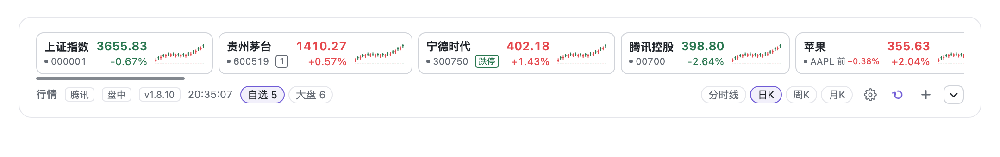
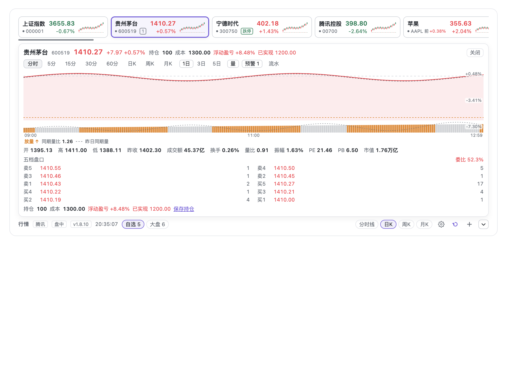
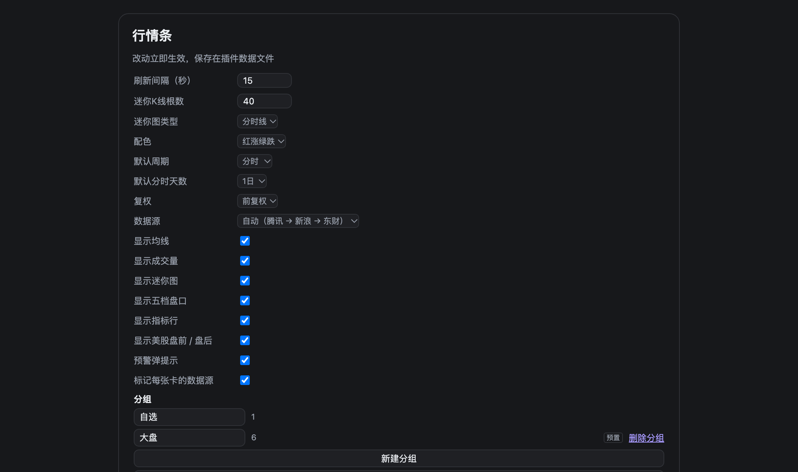

# dsh-stock-dock

[中文](README.md) · **English**


A quote strip pinned under the DeepSeek Harness composer for A-shares, Hong Kong and US securities. Add symbols by code, name or pinyin, keep several watchlist groups, and see name, code, price, change, limit marks, a per-card source dot and a mini daily K-line. The detail panel adds intraday (1/3/5 days with volume and a percentage axis), 5/15/30/60-minute, daily/weekly/monthly charts (three adjust modes), MA5/10/20/60, a five-level order book, A-share valuation fields, a position cost line, a trade ledger with realised P/L and price alerts. Two tools, `stock_quote` and `stock_events`, let the model read quotes, announcements and the daily billboard.





> Quotes come from public endpoints as snapshots. Display only — **not investment advice**, not for trading decisions.

> **Package id**: the repo and the marketplace entry are called `dsh-stock-dock`; the npm id is still `@local/dsh-stock-ticker` so existing `link:` installs keep working. Both `/dsh-stock-ticker` and `/dsh-stock-dock` route prefixes are served.

## Features

- **Strip**: always under the composer; wheel or trackpad horizontal swipe, drag to scroll, hover progress bar; red-up/green-down (switchable), A-share limit marks, a source dot per card
- **Settings panel**: a gear in the header opens it right inside the strip (no dependence on the DSH settings page); switch the data source (auto/Tencent/Sina/Eastmoney), default chart, adjust mode and cadence, and toggle each display element (mini chart, MAs, volume, order book, metrics row, source dot, alert toast, US pre/post market)
- **Mini chart type**: the small chart on each card switches between `intraday line / daily / weekly / monthly` from the header or settings; the line follows the poll for A-shares and Hong Kong, and US cards fall back to daily candles because free intraday is unavailable
- **Card management**: a hover `×` removes one symbol, cards can be dragged into a new order, the trailing `＋` opens search
- **Search**: code, Chinese name or pinyin, merged from Eastmoney suggest and Tencent smartbox
- **Watchlist groups**: several lists switched by the header pills; a "market" group is seeded on first install (SSE, SZSE, ChiNext, STAR 50, Hang Seng, Nasdaq)
- **Charts**: `intraday / 5m / 15m / 30m / 60m / daily / weekly / monthly`; intraday overlays 1/3/5 days with day separators, volume and a percentage axis, and the one-day view adds the previous session's same-time volume plus the same-time ratio, with orange bars for expansion and grey for contraction; K-lines switch forward/backward/raw adjust, MA and volume toggles, hover crosshair with a readout
- **Order book**: five bids and asks plus the bid/ask ratio
- **A-share fields**: turnover, turnover rate, volume ratio, amplitude, P/E, P/B, float and total market cap
- **US pre/post market**: opt-in; cards and the detail header show the extended-hours price, percent and timestamp (from Sina's `gb_` rows)
- **Positions and trades**: shares/cost draw the cost line; recording buys and sells yields weighted-average cost and realised P/L, and one click rebuilds the position from the ledger
- **Price alerts**: above/below targets surfaced as a toast; acknowledging re-arms but waits for the price to leave the line
- **Agent tools**: `stock_quote` (batch quotes) and `stock_events` (announcements / daily billboard)
- **Settings page**: refresh interval, mini-chart type and bars, colours, default period, default intraday days, adjust mode, MA/volume/toast switches, group management
- **Optional sidebar page**: with [dsh-better-sidebar](https://github.com/omdsh-dev/DSH-better-sidebar) the same panel opens as a tab, and polling pauses while the tab is hidden
- **Frugal polling**: cadence follows each venue's session, drops on weekends and holidays, pauses when the page is hidden, and backs off after failures
- **Small poll payload**: mini charts are no longer part of the quote poll; `/sparklines` serves them once with an ETag, taking thirty symbols from ~129 KB to ~22 KB per poll



## Install

The repository root is the installable bundle (`package.json` plus `cordis.patch.yml`).

```text
plugin_manager  action: install_bundle  target: github:mimidor/dsh-stock-dock
```

Or point at a checkout:

```text
plugin_manager  action: install_bundle  target: /path/to/dsh-stock-dock
```

Requires DSH 0.2.x with the Web GUI. Reload the page afterwards; the Host half additionally needs a plugin restart (saving the config once triggers one).

## Usage

| Action | How |
| --- | --- |
| See quotes | The strip appears under the composer |
| Open a chart | Click a card; click again or press close |
| Switch period | `intraday / 5m / 15m / 30m / 60m / daily / weekly / monthly` |
| Switch adjust | The select next to the K-line tabs |
| Add/remove/reorder | Search in the form; hover `×` to remove; drag cards; the trailing `＋` opens search |
| Switch group | The pills in the header (shown when more than one group exists) |
| Positions/trades | Detail footer: shares/cost, and the trade ledger with "rebuild position" |
| Set an alert | Detail → alerts → above/below plus a price |
| Plugin settings | The gear in the strip header; also DSH settings → 行情条 (a first-class nav section next to General/Models) |

Symbols accept `600519`, `sh600519`, `600519.SH`, `00700`, `hk00700`, `00700.HK`, `AAPL`, `usAAPL`, `hkHSI`, `usIXIC`; at most 30 per group.

## Configuration

```yaml
- id: stock-ticker
  name: "@local/dsh-stock-ticker"
  config:
    symbols: [sh000001, sz399001, sh600519, sh510300, hk00700, usAAPL]
    refreshSeconds: 15   # 5-300, used as-is while a market is trading
    klineDays: 40        # 10-120 daily bars (the mini chart shows at most 20)
    colorMode: cn        # cn = red up, intl = green up
    tool: true           # register stock_quote and stock_events
    toolSymbols: []      # watchlist the tools fall back to; empty = symbols
```

Runtime preferences written by the settings page live in the plugin's data file and override `refreshSeconds`, `klineDays` and `colorMode`; the profile config is the seed and the fallback.

## Data sources

| Purpose | Endpoint | Cache |
| --- | --- | --- |
| Quotes, order book, A-share fields (primary) | Tencent `qt.gtimg.cn/q=...` (GBK) | 3s |
| Quote fallback 1 | Sina `hq.sinajs.cn/list=...` (GBK, needs Referer) | 3s |
| Quote fallback 2 | Eastmoney `push2.eastmoney.com/api/qt/ulist.np/get` | 3s |
| Daily/weekly/monthly K, three adjust modes | Tencent `proxy.finance.qq.com/.../newfqkline/get` | 5 min |
| 5/15/30/60-minute K | Tencent `.../kline/mkline` | 60s |
| Intraday, 1 day / same-time ratio | Tencent `.../minute/query` normally; `day/query` for the previous-session baseline | 20s |
| Intraday, 3/5 days (A-share, Hong Kong) | Tencent `web.ifzq.gtimg.cn/appstock/app/day/query` | 20s |
| Search | Eastmoney suggest + Tencent smartbox | not cached |
| Announcements | Eastmoney `np-anotice-pc.eastmoney.com/api/security/ann` | on call |
| Daily billboard | Eastmoney `datacenter-web.eastmoney.com` (`RPT_DAILYBILLBOARD_DETAILSNEW`) | on call |
| US pre/post market | Sina `hq.sinajs.cn/list=gb_...` (columns 21–24: price, percent, time) | 60s, only while the preference is on |
| History fallback | Eastmoney `push2his`; frequently refused by the server on some networks, then cooled down for 5 minutes | — |

Host routes (same origin; `/dsh-stock-dock` is an alias):

```text
GET  /dsh-stock-ticker/quotes?symbols=...&source=tencent|sina|eastmoney&group=<id>
GET  /dsh-stock-ticker/sparklines?symbols=...&days=40&type=intraday|day|week|month
GET  /dsh-stock-ticker/kline?symbol=...&period=day|week|month|m1|m5|m15|m30|m60&adjust=qfq|hfq|none&limit=40&refresh=1
GET  /dsh-stock-ticker/trend?symbol=...&days=1|3|5&refresh=1
GET  /dsh-stock-ticker/search?q=<term>&limit=8
GET  /dsh-stock-ticker/trades?symbol=...
GET  /dsh-stock-ticker/settings
GET  /dsh-stock-ticker/health
POST /dsh-stock-ticker/config
POST /dsh-stock-ticker/prefs
POST /dsh-stock-ticker/alerts
POST /dsh-stock-ticker/holdings
POST /dsh-stock-ticker/trades
POST /dsh-stock-ticker/groups
```

Upstream failures always answer **HTTP 200 with `{ ok:false, error }`**; only a malformed request uses 400/403/404. `/sparklines` honours `If-None-Match` and answers 304 while the data is unchanged.

## Local data

Groups, positions, trades, alerts and preferences live in a host-side JSON file:

```text
<$DSH_HOME|~/.dsh>/dsh-stock-dock/store.json      # override with DSH_STOCK_DOCK_STORE
```

Writes go through a temp file and a rename; an unreadable file is renamed to `store.json.broken-<timestamp>` and kept. Missing fields are filled with defaults on load.

## Tests

```bash
npm run check          # syntax
npm run lint           # oxlint
npm test               # 58 tests: parser fixtures, pre-market parsing, ledger arithmetic, alerts, sessions, store, tools, render
npm run test:coverage  # Node's built-in coverage (~79% lines)
npm run verify         # 177 checks, live endpoints
npm run verify:offline # no network
npm run pack:check     # published file list
npm run check:readme   # zh/en README outline and routes in sync
npm run preview        # render docs/preview/*.html and the screenshots from the real components
```

`tests/fixtures/` holds payload snapshots captured from the real endpoints. `tests/render.test.mjs` renders the real client components with a miniature React and fake DOM — the failure it exists for is a render-time throw, which makes the host drop the entire slot.

## Known limitations

- Public, unofficial endpoints: they can rate-limit, change fields or disappear. No SLA.
- **US intraday is unavailable** (Tencent returns a single point and Eastmoney's `trends2` is refused on some networks); Hong Kong 3/5-day intraday works. Pre/post market exposes a price snapshot only, no intraday line.
- **The same-time ratio is not archived**: it compares with Tencent's previous session and covers A-shares and Hong Kong only; longer history needs the future minute-bar archive.
- **US mini intraday is unavailable**: free sources have no reliable US intraday, so US cards fall back to daily candles when the mini chart is set to the intraday line.
- Indices have no order book, Hong Kong depth comes back as zeroes, and minute K-lines exist for A-shares only.
- Eastmoney's history host is a fallback only; a refused host cools down for five minutes.
- Holidays are inferred from quote timestamps; a half-day session or a delayed quote can take a poll or two to notice.
- Display and bookkeeping only: no orders, no session or agent data.

## Troubleshooting

**Quickest way to look at a stock?** The strip is under the composer; click a card. The trailing `＋` or the header slider button opens search.

**Which markets?** A-shares (stocks, indices, ETFs, Beijing), Hong Kong (including HSI) and the US (including Nasdaq/Dow/S&P). Tencent first, then Sina, then Eastmoney.

**Is the data delayed?** It is a snapshot of public endpoints; while a market trades it polls every `refreshSeconds` (default 15 s), slows down outside sessions and backs off after failures.

**Can it trade or read my positions?** No trading. Positions and trades are what you recorded in the plugin, stored in a local JSON file.

**Why does a card have no order book?** Indices have none, and Tencent returns zeroes for Hong Kong depth.

**When does an acknowledged alert fire again?** It re-arms immediately, but only fires after the price leaves the target once.

## Collection

The repository follows the [awesome-dsh-plugin](https://github.com/awesome-dsh-plugin/awesome-dsh-plugin) layout: `dsh.bundle` in `package.json`, a root `cordis.patch.yml`, and the `dsh-plugin` topic. The pending entry is in [`contrib/awesome-dsh-plugin.yml`](contrib/awesome-dsh-plugin.yml).

## License

[MIT](LICENSE)
