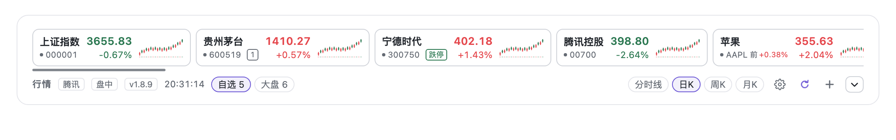
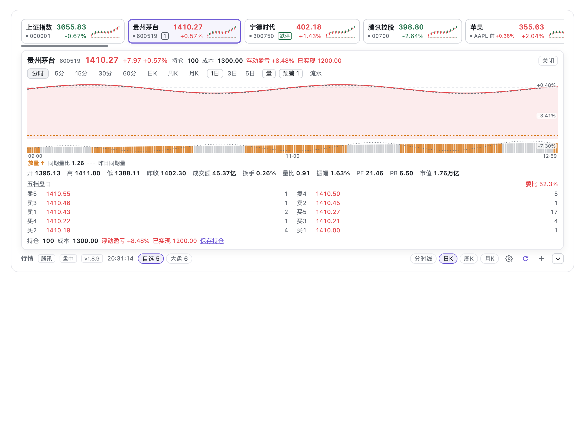
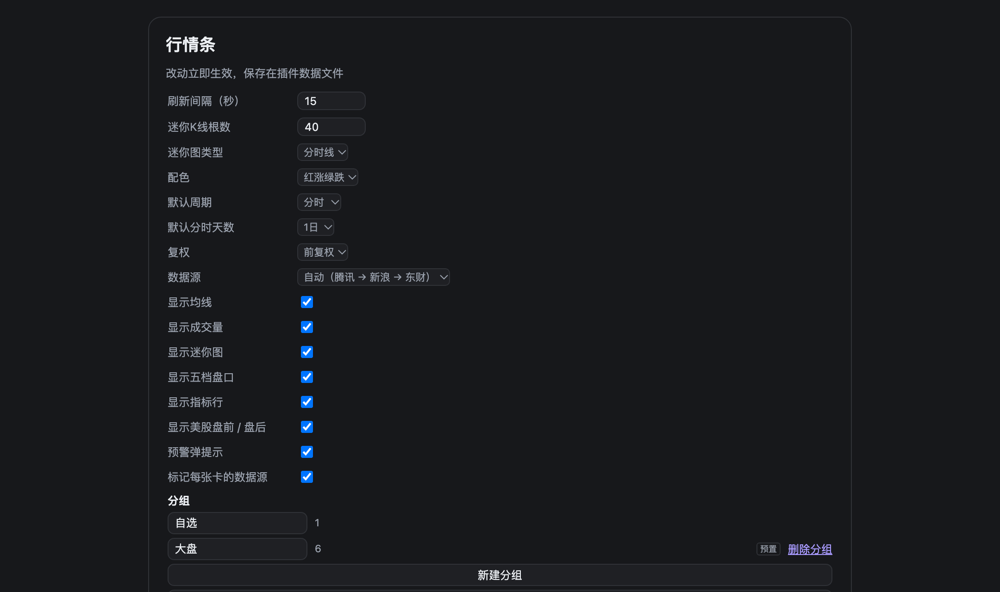

# dsh-stock-dock

**中文** · [English](README.en.md)


钉在 DeepSeek Harness 输入框下方的自选股行情条：A 股 / 港股 / 美股一张横条，按代码、名称或拼音搜索加标的，可分组；每张卡有名称、代码、价格、涨跌幅、涨跌停标记、数据源点和迷你 K 线。点开卡片是详情面板：分时（1/3/5 日）、5/15/30/60 分钟、日/周/月 K（三种复权）、MA5/10/20/60、成交量、五档盘口、A 股量价指标、持仓成本线、交易流水与已实现盈亏、价格预警。另外注册 `stock_quote` 与 `stock_events` 两个工具，让模型能直接读行情、公告和龙虎榜。





> 行情来自公开接口的快照数据，仅供查看，**不构成任何投资建议**，不用于交易决策。

> **包名说明**：仓库和插件市场条目叫 `dsh-stock-dock`，包名仍是 `@local/dsh-stock-ticker`（已有 profile 的 `link:` 安装靠它）。路由同时挂 `/dsh-stock-ticker` 与 `/dsh-stock-dock`，两者等价。

## 功能

- **行情条**：常驻输入框下方，滚轮或触摸板左右滑动转横向、按住可拖动、悬停浮出进度条；涨红跌绿（可切国际配色），A 股打 `涨停`/`跌停`，每张卡带数据源点
- **设置面板**：头部齿轮直接打开（不依赖 DSH 设置页）；可切数据源（自动/腾讯/新浪/东财）、默认图表、复权、刷新节奏，以及逐项显示开关（迷你图、均线、成交量、五档盘口、指标行、数据源标记、预警提示、美股盘前/盘后）
- **迷你图类型**：每张卡右侧的小图可在顶部栏或设置里切 `分时线 / 日K / 周K / 月K`；分时线随行情刷新，A 股/港股优先，美股分时源不可用时自动退回日K
- **卡片管理**：悬停出现 `×` 单只移除，拖拽卡片调整顺序，末尾 `＋` 直接打开搜索
- **搜索添加**：按代码、中文名或拼音搜（东财 suggest + 腾讯 smartbox 双源合并）
- **分组自选**：多个自选表，头部胶囊切换；新装有「大盘」预置组（上证/深证/创业板/科创50/恒生/纳斯达克）
- **详情图表**：`分时 / 5分 / 15分 / 30分 / 60分 / 日K / 周K / 月K`；分时 1/3/5 日叠加（按交易日分隔、带成交量柱与百分比轴），单日分时叠加上一交易日同期量虚线，柱色橙=放量/灰=缩量，并显示同期量比；K 线可切前/后/不复权，MA 与成交量副图可开关，鼠标划过有十字光标与读数
- **五档盘口**：买卖各五档（价 + 量）和委比
- **A 股指标**：成交额、换手率、量比、振幅、市盈率、市净率、流通市值 / 总市值
- **美股盘前 / 盘后**：可选开关，打开后卡片与详情会显示盘前/盘后价格、涨跌幅和时间（数据来自新浪 `gb_` 行）
- **持仓与流水**：填股数/成本画成本虚线；记买卖流水后按加权平均成本算已实现盈亏，并可一键"按流水同步持仓"
- **价格预警**：上破/下破目标价，命中弹提示；确认后要等价格离开目标价才会再次触发
- **agent 工具**：`stock_quote`（批量行情）与 `stock_events`（公告 / 龙虎榜）
- **插件设置页**：刷新间隔、迷你图类型与根数、配色、默认周期、默认分时天数、复权、均线/成交量/预警提示开关、分组管理
- **可选侧栏页**：装了 [dsh-better-sidebar](https://github.com/omdsh-dev/DSH-better-sidebar) 时可作为右侧栏标签页；标签页不可见时自动暂停轮询
- **省电的刷新**：按三地交易时段给节奏，周末与节假日自动降频；页面隐藏或配置面板打开时暂停，失败退避到最长 2 分钟
- **轻量轮询**：迷你 K 线不再随行情轮询下发，改由 `/sparklines` 单独取并用 ETag 复用；30 只标的单次轮询从 ~129 KB 降到 ~22 KB



## 安装

本仓库本身就是可安装的 bundle（`package.json` 与 `cordis.patch.yml` 在根目录）。

```text
plugin_manager  action: install_bundle  target: github:mimidor/dsh-stock-dock
```

或者克隆后指向目录：

```text
plugin_manager  action: install_bundle  target: /path/to/dsh-stock-dock
```

要求 DSH 0.2.x，且开启了 Web GUI。安装后**刷新页面**。Host 半区改动需要重启插件（保存一次配置即可触发），Client 半区改动刷新页面即可。

## 使用

| 操作 | 怎么做 |
| --- | --- |
| 看行情 | 输入框下方自动出现 |
| 看详情 | 点卡片展开，再点一次或按「关闭」收起 |
| 切图表 | `分时 / 5分 / 15分 / 30分 / 60分 / 日K / 周K / 月K` |
| 切复权 | K 线页签右侧的下拉 |
| 加/删/排序 | 配置里搜索添加；卡片悬停 `×` 删除；拖拽排序；末尾 `＋` 打开搜索 |
| 换分组 | 头部胶囊（有多个分组时出现） |
| 记持仓/流水 | 详情底部「持仓」填股数成本；「流水」记买卖、同步持仓 |
| 设预警 | 详情「预警」→ 上破/下破 + 价格 |
| 插件设置 | 行情条头部齿轮；也可从 DSH 设置 → 行情条（一级入口，和「通用设置」「模型」同级）进入 |

标的写法：`600519`、`sh600519`、`600519.SH`、`00700`、`hk00700`、`00700.HK`、`AAPL`、`usAAPL`、`hkHSI`、`usIXIC`，每组最多 30 个。

## 配置

```yaml
- id: stock-ticker
  name: "@local/dsh-stock-ticker"
  config:
    symbols: [sh000001, sz399001, sh600519, sh510300, hk00700, usAAPL]
    refreshSeconds: 15   # 5–300，仅盘中直接用这个值
    klineDays: 40        # 10–120，日K 根数（迷你图最多显示 20 根）
    colorMode: cn        # cn = 红涨绿跌，intl = 绿涨红跌
    tool: true           # 是否注册 stock_quote / stock_events
    toolSymbols: []      # 工具缺省自选；留空时用 symbols
```

设置页改的偏好写在插件数据文件里，会覆盖 config 的同名项（`refreshSeconds` / `klineDays` / `colorMode`）；config 是"出厂默认 + 首次种子"。

## 数据来源与刷新

| 用途 | 接口 | 缓存 |
| --- | --- | --- |
| 行情 + 五档 + 指标（主源） | 腾讯 `qt.gtimg.cn/q=...`（GBK） | 3s |
| 行情备源 1 | 新浪 `hq.sinajs.cn/list=...`（GBK，需 Referer） | 3s |
| 行情备源 2 | 东财 `push2.eastmoney.com/api/qt/ulist.np/get` | 3s |
| 日/周/月 K（三种复权） | 腾讯 `proxy.finance.qq.com/.../newfqkline/get` | 5 min |
| 5/15/30/60 分钟 K | 腾讯 `.../kline/mkline` | 60s |
| 分时 1 日 / 同期量比 | 腾讯 `.../minute/query`（普通）；`day/query` 取 2 日算昨日同期量 | 20s |
| 分时 3/5 日（A股/港股） | 腾讯 `web.ifzq.gtimg.cn/appstock/app/day/query` | 20s |
| 搜索 | 东财 suggest + 腾讯 smartbox | 不缓存 |
| 公告 | 东财 `np-anotice-pc.eastmoney.com/api/security/ann` | 调用时取 |
| 龙虎榜 | 东财 `datacenter-web.eastmoney.com`（`RPT_DAILYBILLBOARD_DETAILSNEW`） | 调用时取 |
| 美股盘前/盘后 | 新浪 `hq.sinajs.cn/list=gb_...`（第 21–24 位：价、涨跌幅、时间） | 60s，仅开关打开时取 |
| 历史备源 | 东财 `push2his`（K线/分时）；本机网络常被服务端断开，失败后冷却 5 分钟 | — |

Host 路由（同源；`/dsh-stock-dock` 是等价前缀）：

```text
GET  /dsh-stock-ticker/quotes?symbols=...&source=tencent|sina|eastmoney&group=<id>
GET  /dsh-stock-ticker/sparklines?symbols=...&days=40&type=intraday|day|week|month
GET  /dsh-stock-ticker/kline?symbol=...&period=day|week|month|m1|m5|m15|m30|m60&adjust=qfq|hfq|none&limit=40&refresh=1
GET  /dsh-stock-ticker/trend?symbol=...&days=1|3|5&refresh=1
GET  /dsh-stock-ticker/search?q=<term>&limit=8
GET  /dsh-stock-ticker/trades?symbol=...
GET  /dsh-stock-ticker/settings
GET  /dsh-stock-ticker/health
POST /dsh-stock-ticker/config
POST /dsh-stock-ticker/prefs
POST /dsh-stock-ticker/alerts
POST /dsh-stock-ticker/holdings
POST /dsh-stock-ticker/trades
POST /dsh-stock-ticker/groups
```

约定：**上游失败一律 HTTP 200 + `{ ok:false, error }`**，不返回 5xx；只有请求本身有问题才用 400/403/404。`/sparklines` 支持 `If-None-Match`，数据没变时回 304。

## 本地数据

分组、持仓、流水、预警、偏好存在宿主侧 JSON 文件里：

```text
<$DSH_HOME|~/.dsh>/dsh-stock-dock/store.json      # 可用 DSH_STOCK_DOCK_STORE 覆盖
```

写入是「先写 `.tmp-<pid>` 再 rename」的原子替换；文件损坏时重命名成 `store.json.broken-<时间戳>` 留着。老版本文件缺字段会自动补默认值。

## 自测

```bash
npm run check          # 语法
npm run lint           # oxlint
npm test               # 58 个测试：解析器 fixture、盘前解析、流水算术、预警、会话、存储、工具、渲染
npm run test:coverage  # 覆盖率（Node 内置，约 79% 行覆盖）
npm run verify         # 177 项：路由、抽样、ETag、三源、盘前、流水、分组、工具、客户端
npm run verify:offline # 跳过联网检查
npm run pack:check     # 发布文件清单
npm run check:readme   # 中英文 README 结构/路由同步
npm run preview        # 用真实组件生成 docs/preview/*.html 与截图
```

`tests/fixtures/` 是真实接口报文快照；`tests/render.test.mjs` 用迷你 React 把真实组件渲染并模拟点击，专门抓"渲染期抛异常导致整个 slot 被清空"这类失败。

## 已知限制

- 数据源是公开非官方接口，可能限流、改字段或不可用；没有 SLA。
- **美股分时不可用**（腾讯只回 1 个点，东财 trends2 在本机被断开）；港股 3/5 日分时可用。盘前/盘后只有价格快照，没有分时。
- **同期量比不落盘**：用腾讯最近 2 个交易日的分钟量算昨日同期量，只覆盖 A 股/港股；更长的历史对比需要后续的分钟量归档。
- **美股迷你分时不可用**：免费源没有可靠美股分时，迷你图选「分时线」时美股卡片会退回日K。
- 指数没有五档，港股五档腾讯返回 0，这两类卡片不显示盘口；分钟 K 只有 A 股有。
- 东财历史接口（`push2his`）在部分网络被服务端直接断开，只作备源并冷却 5 分钟。
- 节假日是从"报价时间不是今天"推断的，半天市或延迟报价可能晚一两轮。
- 只做展示与记账，不下单、不读取会话或 agent 数据。

## 常见问题

**怎么快速看一只股票？** 输入框下方就是行情条，点卡片展开详情；末尾 `＋` 或头部滑杆按钮可搜索添加。

**支持哪些市场？** A 股（个股、指数、ETF、北交所）、港股（含恒指）、美股（含纳指/道指/标普）。腾讯取不到时切新浪、再切东财。

**数据有延迟吗？** 是公开接口快照；盘中按 `refreshSeconds`（默认 15 秒）刷新，休市/收盘自动降频，失败退避。

**能交易吗？能读我的持仓吗？** 不能交易；持仓和流水是你在插件里自己记的，只存本机 JSON。

**为什么有的卡片没有五档盘口？** 指数没有盘口；港股五档腾讯返回 0。

**预警怎么再次触发？** 命中后点「知道了」重新武装，但要等价格离开目标价才会再次触发。

## 收录

仓库按 [awesome-dsh-plugin](https://github.com/awesome-dsh-plugin/awesome-dsh-plugin) 收录要求组织：根目录 `package.json` 声明 `dsh.bundle`，有 `cordis.patch.yml`，带 `dsh-plugin` 话题。待提交条目见 [`contrib/awesome-dsh-plugin.yml`](contrib/awesome-dsh-plugin.yml)。

## 许可

[MIT](LICENSE)
